# ELEC 3 – Node.js: Self-Paced Learning Assignment

| | |
|---|---|
| **Name** | Justine Barlaan |
| **Section** | IV-BSIT B |
| **Course** | ELEC 3 – Node.js |
| **Instructor** | Carl Gustaf Patrik B. Ferrer |

## Activities

### Set 1 (Nov 23–29, 2026)

| Activity | Description | Folder |
|---|---|---|
| N1 | Project setup and package management with npm and package.json | [set1/n1-setup](set1/n1-setup) |
| N2 | Modular calculator using custom modules, `require()`, and `module.exports` | [set1/n2-calculator](set1/n2-calculator) |
| N3 | File manager using the `fs` and `path` modules | [set1/n3-file-manager](set1/n3-file-manager) |

### Set 2 (Nov 30–Dec 6, 2026)

| Activity | Description | Folder |
|---|---|---|
| N4 | Basic HTTP server with routing and a 404 page | [set2/n4-server](set2/n4-server) |
| N5 | REST-style API with GET, POST, PUT, and DELETE | [set2/n5-api](set2/n5-api) |
| N6 | Middleware (logger and JSON header) and API testing | [set2/n6-middleware](set2/n6-middleware) |

## How to Run

**N1 – Project Setup**
```bash
cd set1/n1-setup
npm install
npm start
```

**N2 – Modular Calculator**
```bash
cd set1/n2-calculator
# Basic operations
node index.js add 12 8
node index.js subtract 20 5
node index.js multiply 6 7
node index.js divide 20 4
node index.js average 10 20 30 40 50

# Error cases
node index.js divide 10 0
node index.js modulo 5 2
```

**N3 – File Manager**
```bash
cd set1/n3-file-manager
# List initial files (3 auto-created)
node index.js list

# Create a file
node index.js create demo.txt "Hello World"

# Read a file
node index.js read demo.txt

# Update (append to) a file
node index.js update demo.txt "Appended line"

# Delete a file
node index.js delete demo.txt

# List all files with details
node index.js list
```

**N4 – Basic HTTP Server** (Set 2)
```bash
cd set2/n4-server
npm install
npm start
# Then open http://localhost:8000 in browser
```

**N5 – REST API** (Set 2)
```bash
cd set2/n5-api
npm install
npm start
# Test with curl or Postman: GET/POST/PUT/DELETE http://localhost:8000/api/students
```

**N6 – Middleware & API Testing** (Set 2)
```bash
cd set2/n6-middleware
npm install
npm start
# Test all endpoints with Postman/Thunder Client
```

## Screenshots

### N1 – Project Setup
| Description | Screenshot |
|---|---|
| npm install, npm start output, and Node & npm version check | 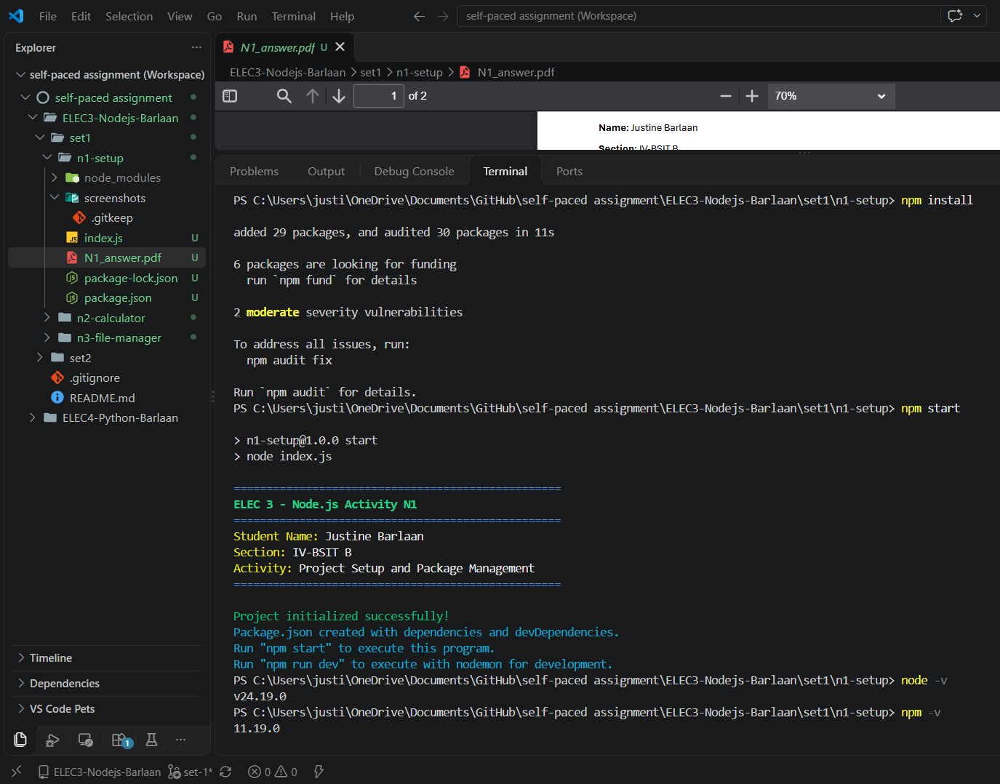 |
| package.json content | _To be added_ |

### N2 – Modular Calculator
| Operation | Screenshot |
|---|---|
| Add | 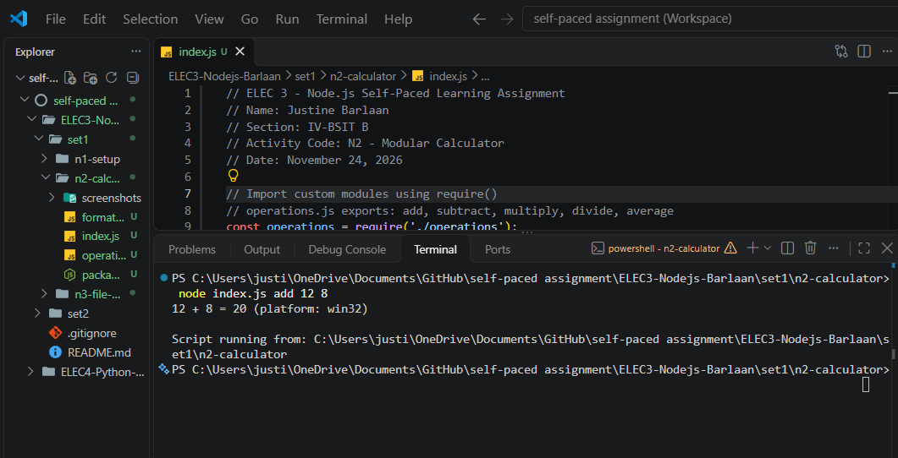 |
| Subtract | 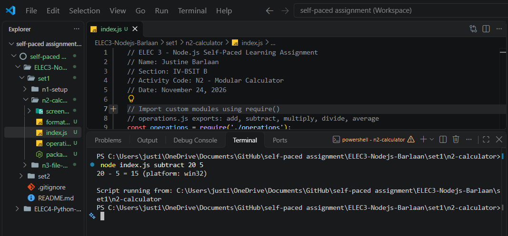 |
| Multiply | 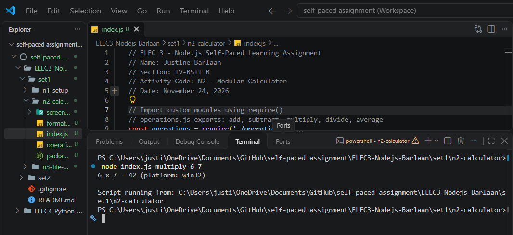 |
| Divide | 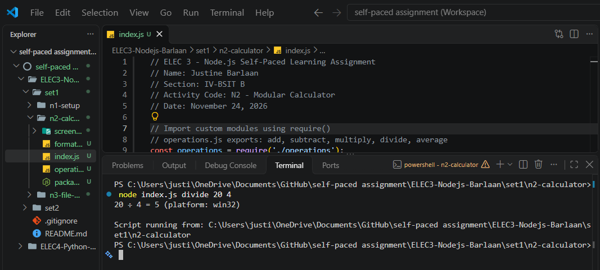 |
| Average | 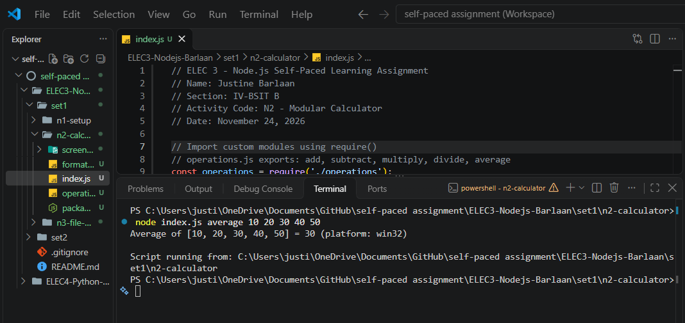 |
| Error: Divide by zero | 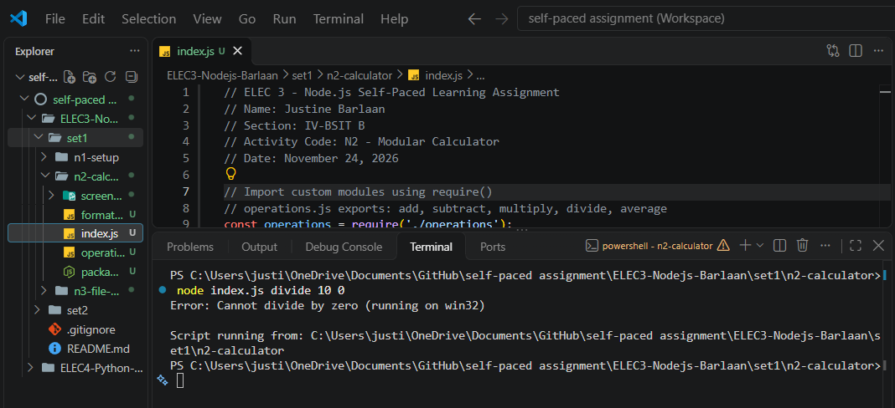 |
| Error: Unknown operation | 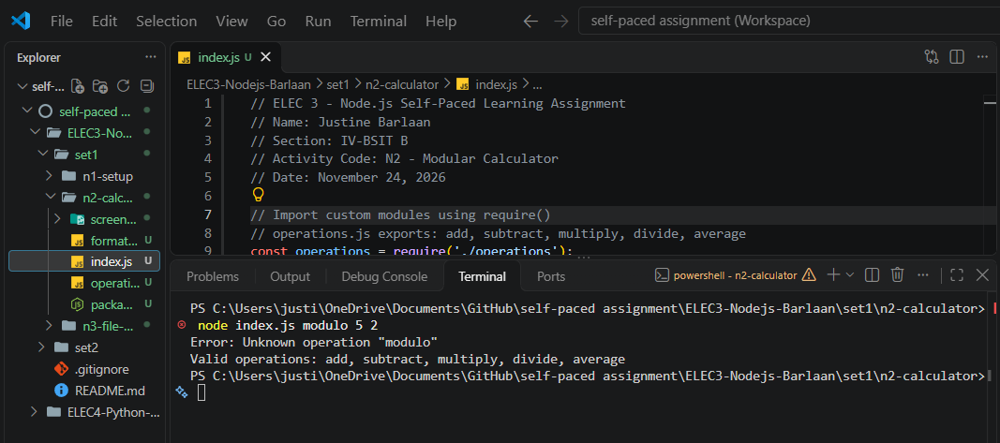 |

### N3 – File Manager
| Command | Screenshot |
|---|---|
| Create file (also creates the 3 initial files) | 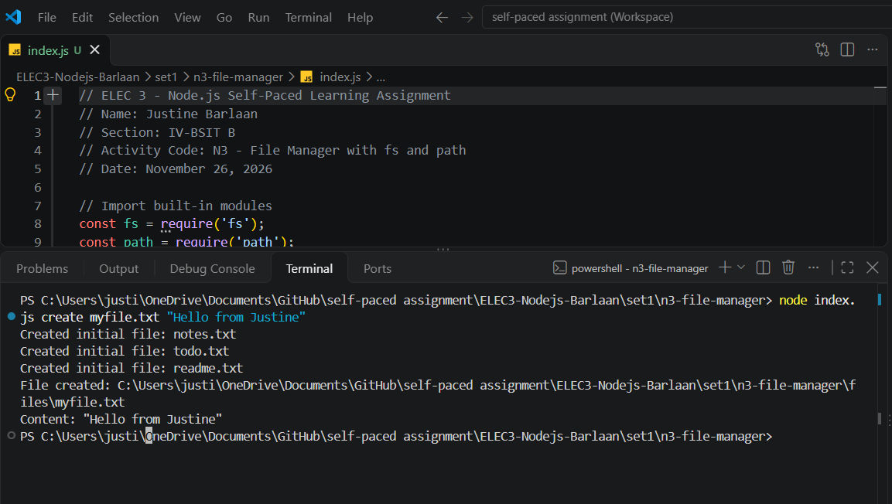 |
| Read file | 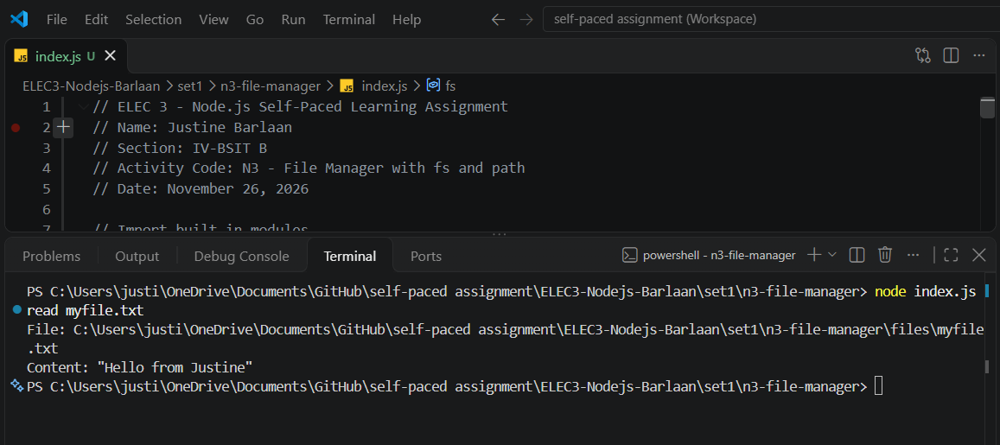 |
| Update file | 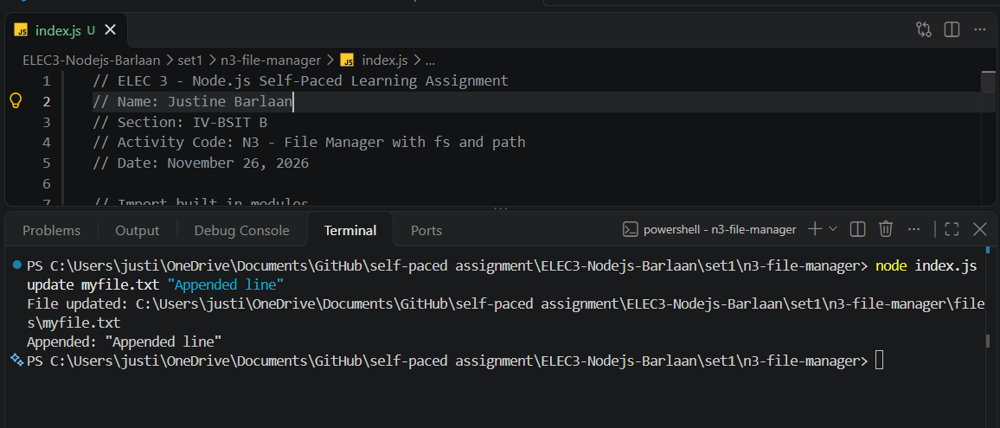 |
| Delete file | 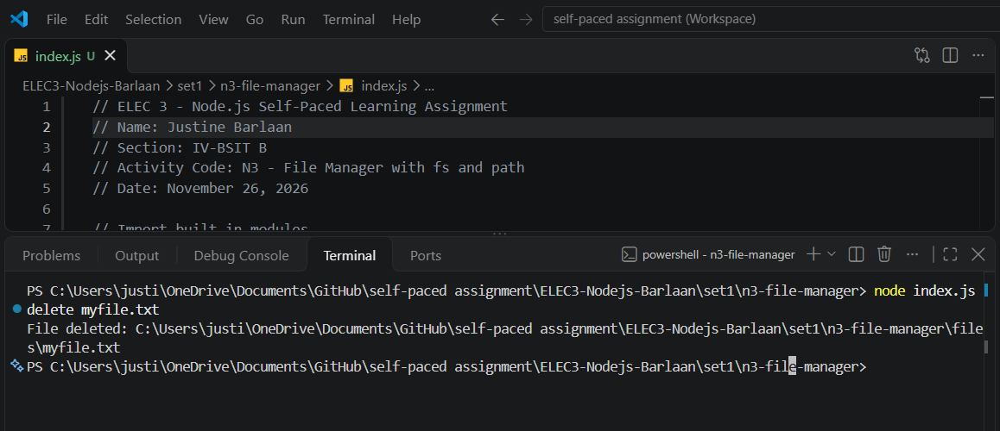 |
| List all files with details | 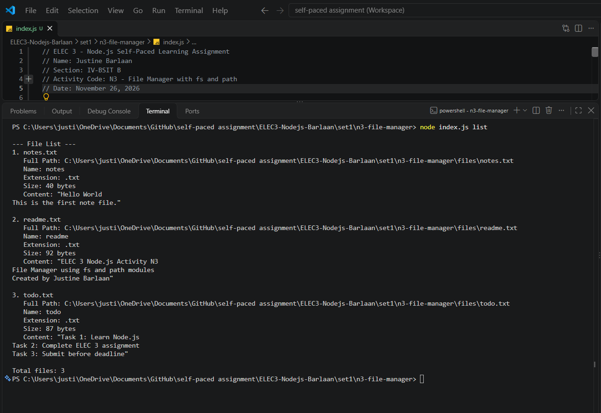 |

### N4 – Basic HTTP Server (Set 2)
| Page | Screenshot |
|---|---|
| Home (/) | _To be added_ |
| About (/about) | _To be added_ |
| Contact (/contact) | _To be added_ |
| 404 Not Found | _To be added_ |

### N5 – REST API (Set 2)
| Endpoint | Screenshot |
|---|---|
| GET /api/students | _To be added_ |
| GET /api/students/:id | _To be added_ |
| POST /api/students | _To be added_ |
| PUT /api/students/:id | _To be added_ |
| DELETE /api/students/:id | _To be added_ |

### N6 – Middleware & API Testing (Set 2)
| Test | Screenshot |
|---|---|
| Logger output in terminal | _To be added_ |
| Successful GET response | _To be added_ |
| Successful POST response | _To be added_ |
| Successful PUT response | _To be added_ |
| Successful DELETE response | _To be added_ |